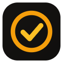
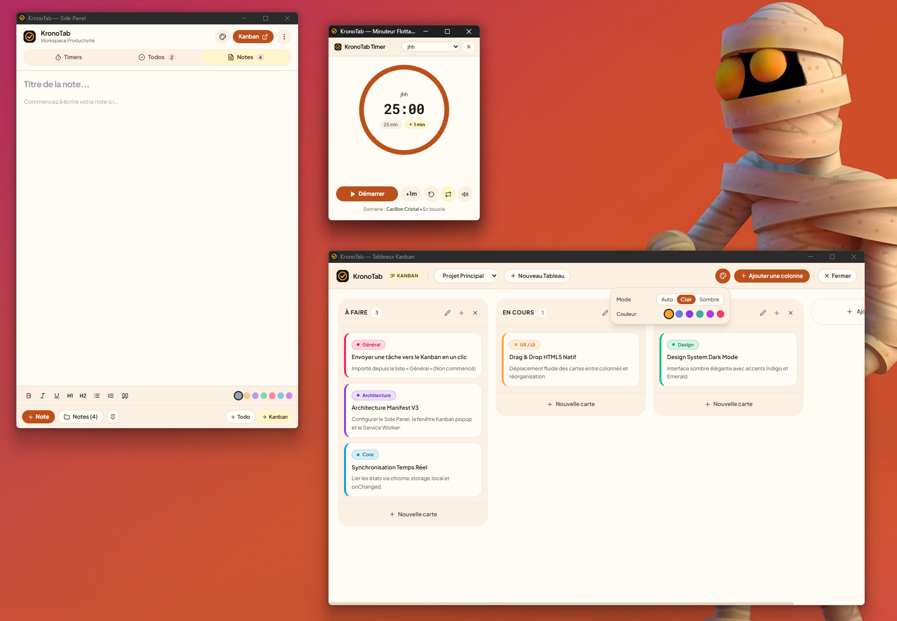
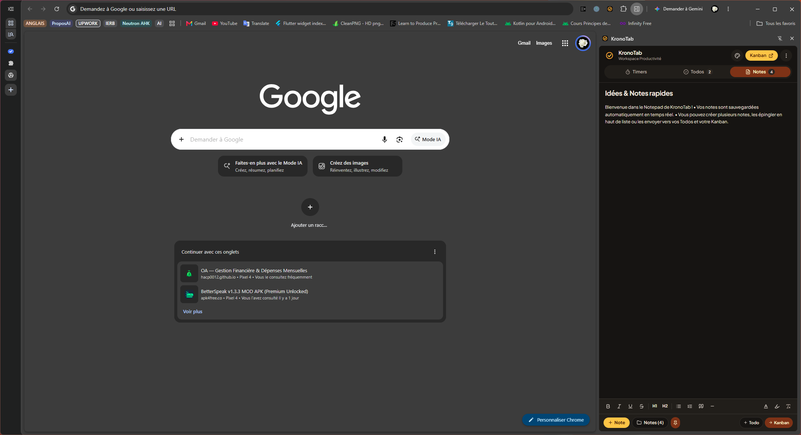
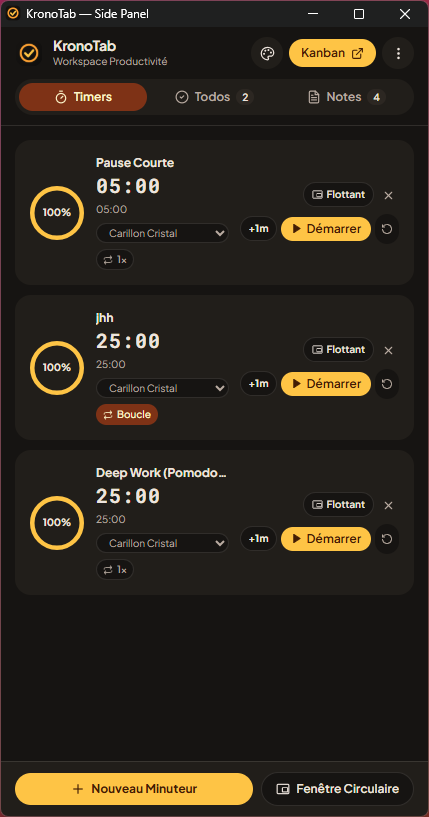
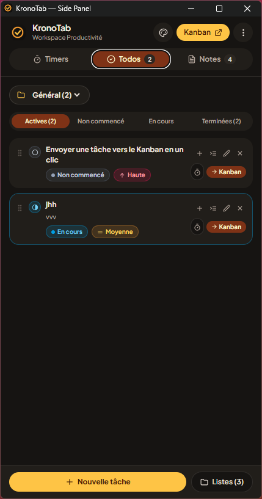

<div align="center">
  

  # KronoTab

  **The All-in-One Productivity Workspace Built for Google Chrome**  
  *Circular Focus Timers • Multi-Todos & Subtasks • Full-Screen Rich Notepad • Multi-Kanban Boards*

  
  
  
  

  <br />

  
</div>

---

## Overview

**KronoTab** is a modern Chrome Extension (Manifest V3) designed to centralize your daily workflow without ever leaving your browser — or directly from your Windows desktop as a standalone application.

Crafted with a **Material Design 3 Flat (*Material You*)** interface and **Google Sans** typography, it synchronizes all your data in real time across the Chrome `Side Panel`, the floating circular timer, and the dedicated Kanban window using `chrome.storage.local`.

---

## Key Features

### 1. Focus Timers & Floating Circular Widget
- **Simultaneous multi-timers** automatically sorted by ascending duration.
- **Exact `hh:mm:ss` duration format** down to the second + quick presets (`10m`, `20m`, `30m`, `45m`, `60m`).
- **Dedicated floating circular window** (`timer.html`) with smooth **60 FPS** ring animation that stays visible even when the Side Panel is closed.
- **Background audio (`chrome.offscreen`) & Looping Alarms**: 5 built-in ringtones (*Crystal Chime*, *Woody Marimba*, *Tibetan Zen Bowl*, *Digital Beep*, *Energetic Pulse*) capable of ringing in a loop even when all extension windows are closed.
- **Quick controls**: discreet **`+1m`** button to extend the current session without altering the saved duration, system notifications with **"OK, got it"** and **"+1 Min"** action buttons, and a live countdown badge on the Chrome extension icon.

### 2. Multi-Todo Lists & Subtasks
- **Customizable multiple lists** (*General*, *Work*, *Personal*, etc.).
- **Rich task management**: title, detailed description, estimated duration, **3 statuses** (*Not started*, *In progress*, *Completed*), and **3 priority levels** (*Low*, *Medium*, *High*).
- **Subtasks & Drag-and-Drop**: reorder tasks via native HTML5 *drag-and-drop*, and indent/outdent tasks with a single click (or by dragging slightly to the right) to turn them into subtasks.
- **One-click bridges**: launch a temporary Focus Timer directly from any task or send a task straight to the first column of your active Kanban board.
- **Clean active view**: completed tasks automatically move out of the main view into the dedicated **"Completed"** filter tab.

### 3. Full-Screen Rich Notepad (Multi-Notes)
- **Borderless full-screen rich text editor** with instant real-time auto-save.
- **Comprehensive formatting toolbar**: Bold, Italic, Underline, Strikethrough, Headings (`H1`, `H2`), Bulleted & Numbered Lists, Blockquotes, Dividers, **Text Color**, **Highlighter (Marker)**, and **Clear Formatting**.
- **Modal search & Pinning**: quickly search notes by title or content, pin important notes to the top, and convert any note into a Todo task or Kanban card.

### 4. Floating Multi-Kanban Window
- **Boards Sidebar** displaying all available Kanban boards with their title, creation date, card count, and quick deletion.
- **Customizable Column Templates** via the Settings menu (*Classic*, *Agile / Dev Sprint*, *Content Creation*, *Personal GTD*, or create your own custom templates).
- **Native HTML5 Drag & Drop** to move cards across columns and **reorder columns** horizontally.
- **Smooth Drag-to-Scroll Navigation**: click and drag anywhere on the board background to pan horizontally without touching the scrollbar.

---

## Installation

### Prerequisites & Building from Source

1. Clone this repository and install dependencies:
   ```bash
   npm install
   ```
2. Build the production bundle (generates the `dist/` folder):
   ```bash
   npm run build
   ```

### Loading the Extension in Google Chrome

1. Open Google Chrome and navigate to:
   ```text
   chrome://extensions/
   ```
2. Enable **Developer mode** in the top-right corner.
3. Click **Load unpacked**.
4. Select the **`dist/`** folder located in the project root.
5. Click the **KronoTab** icon in your Chrome toolbar to open the Side Panel.

---

## Tip: Launch KronoTab as a Standalone Desktop App

You can create a shortcut on your Windows Desktop to launch **KronoTab** in its own dedicated window (**435 × 820 px**) without opening a full browser window:

1. Copy your Extension ID from `chrome://extensions/` (or open the **⋮ → About & Shortcut Tutorial** menu inside KronoTab to copy the pre-filled command in one click).
2. Right-click on your Windows Desktop → **New** → **Shortcut**.
3. Paste the following command, replacing `[EXTENSION_ID]` with yours:
   ```text
   "C:\Program Files\Google\Chrome\Application\chrome.exe" --app="chrome-extension://[EXTENSION_ID]/sidepanel.html?standalone=1" --window-size=435,820
   ```
4. Name the shortcut **KronoTab** and pin it to your Windows taskbar.

---

## Screenshots

### Native Integration in Chrome Side Panel (Dark Mode & Notepad)
<div align="center">
  
</div>

<br />

### Focus Timers & Multi-Todos (Dark Amber Theme)
<div align="center">
  
  &nbsp;&nbsp;
  
</div>
